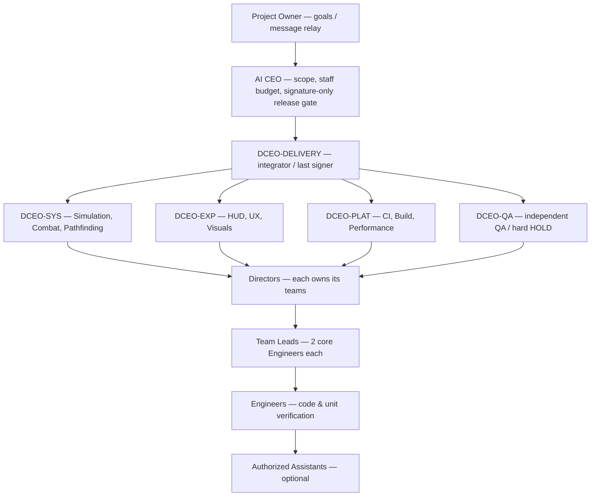

# Ant Kingdom — Team Map / Current command chain
**Current state: STANDBY — Governance V2 not yet approved or activated.** This is a proposed layout, not six new AI chats. Round ROYAL-01 has been completed, PR #91 merged into `main` at `7d2458a13154716b09649903d1b26c86c8848845`. No new game tasks are assigned here.

**Machine-readable live roster:** [TEAM-REGISTRY.json](TEAM-REGISTRY.json) · [Signed Release Board](RELEASE-SIGNATURES.md) · [Governance V2 draft](https://github.com/tanawutmalirum29-ux/appointment-CEO/pull/2)

## Proposed chain (NONE OF THESE NEW SLOTS IS AN ACTIVE APPOINTMENT YET)

**Schematic only:** the merged `Directors` node shows a *class of positions*, not one Director shared by four Deputies. Every real Director/Lead/Engineer/Assistant must have exactly one `parent_role_id` in the JSON when appointed. Route instructions **one supervisor/subordinate edge at a time**; cross-team consults go up to nearest common ancestor and back down, not peer-to-peer orders.

## Current V2 appointments
**None.** `appointments: []` means no new V2 role has a verified real-chat ACK. Historical ROYAL-01 Director/Team/Engineer records remain archived; closing completed work does not automatically revoke those role identities. The new V2 org chart must not assign new work until authorized Owner goal, CEO transition and staged appointments.

## Rules for the Roster Steward
1. Owner/CEO approves governance and round staffing envelope. CEO appoints Delivery; Delivery appoints domain Deputies; Deputies appoint Directors; Directors appoint Leads; Leads appoint two core Engineers. Helper only after permitted capacity.
2. Real chat receives appointment via Owner's short relay and posts `APPOINTMENT_ACK` with Issue permalink. Only then add a row with `ACTIVE`. A proposed role slot is NOT an activated person.
3. Every direct parent reports `ORG_DELTA` **up one edge**; the Delivery-appointed steward edits both this page and `TEAM-REGISTRY.json` together; inspect unique IDs, parent links, cycles, scope ownership and current Task Issues before saving. Show the **registry_version**, actual changed roles and signed update URL.
4. Every signed candidate SHA belongs on separate [Release Signature Board](RELEASE-SIGNATURES.md); a roster row is not a release signature. Signatures are invalid if release HEAD changes.
5. For rapid roster maintenance, Delivery may propose a separate `org/registry` branch linked from `main` as the live source; a branch is not created until CEO approves that workflow. Never push gameplay or unapproved code to `main`.
